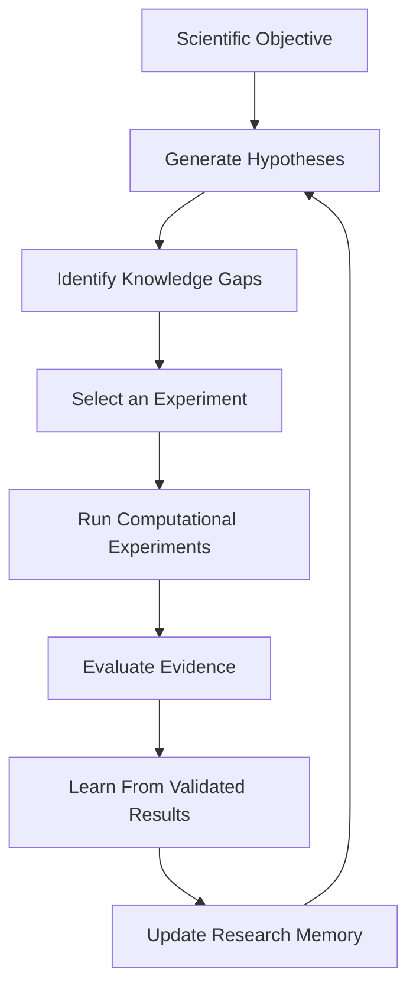

# ChemFlow

### From AI that predicts scientific outcomes to AI that investigates scientific questions.

**ChemFlow is an AI-powered scientific research system designed to investigate scientific problems through continuous cycles of hypothesis generation, computational experimentation, evaluation, and learning.**

What if AI could do more than answer scientific questions? What if it could investigate them?

---

## 1. The Problem

Scientific discovery is a long and resource-intensive process.

Researchers often have to:

- Explore numerous possible explanations.
- Design and conduct experiments.
- Analyse results and identify patterns.
- Learn from unsuccessful experiments.
- Repeat the process until reliable evidence emerges.

Traditional AI can help predict outcomes and analyse data. But making a prediction is only one part of scientific research.

**The bigger opportunity is to build AI systems that can participate in the investigative process itself.**

## 2. Our Concept

ChemFlow explores a new approach: an AI research agent that can investigate a scientific objective over multiple research cycles.

Instead of simply receiving a question and returning an answer, ChemFlow works through a continuous research process:

Each cycle builds on previous work, allowing the system to continue investigating rather than starting from scratch.

## 3. Our Objective

Our objective is to develop an AI system that can:

- **Investigate:** Break down scientific objectives into testable hypotheses.
- **Experiment:** Run computational experiments to evaluate those hypotheses.
- **Evaluate:** Compare outcomes against evidence instead of accepting every prediction.
- **Learn:** Improve its research models using validated information.
- **Remember:** Preserve previous hypotheses, experiments, findings, and failures.
- **Continue:** Identify unanswered questions and decide what to investigate next.

The long-term goal is to make scientific investigation more systematic, iterative, and accessible.

## 4. What Makes ChemFlow Innovative?

### 1. From answering to investigating

Most conventional AI interactions are centred around individual prompts and responses.

ChemFlow is designed around an ongoing research process. It doesn't just produce an output; it uses results to guide its next investigation.

### 2. Persistent research memory

Research does not have to restart with every session.

ChemFlow maintains records of previous experiments, hypotheses, findings, failures, and approvals. It can resume earlier research and build on what has already been learned.

### 3. Evidence-driven conclusions

A prediction should not automatically become a scientific finding.

ChemFlow evaluates results against evidence, uses independent validation, and distinguishes between validated, provisional, inconclusive, and rejected findings.

### 4. Intelligent experiment selection

Not every experiment is equally useful.

ChemFlow evaluates possible experiments and selects what to investigate next, considering expected improvement, exploration, and available computational budgets.

### 5. Learning through investigation

Validated results can be used to update and improve the system's research models. Model versions and regression checks help ensure that improvements do not silently reduce performance.

**The central innovation is combining AI-driven experimentation, persistent memory, evidence evaluation, and iterative learning into one research workflow.**

## 5. Practical Applications

ChemFlow's current research prototype focuses on computational molecular solubility research. The broader architecture could potentially support several scientific domains.

| Field               | Potential application                                                                     |
| ------------------- | ----------------------------------------------------------------------------------------- |
| Drug discovery      | Investigating molecular properties and identifying promising candidates for further study |
| Chemistry           | Exploring relationships between molecular structures and their properties                 |
| Materials science   | Investigating properties of candidate materials                                           |
| Biology             | Analysing biological datasets and exploring scientific hypotheses                         |
| Scientific research | Automating parts of repetitive computational investigation                                |

These are potential directions for future development, not claims that ChemFlow currently performs all these tasks.

## 6. What We Have Built

ChemFlow is built as a research layer on top of **DeepChem**, an open-source machine-learning toolkit for scientific applications.

Our current prototype includes:

- **Research Agent:** Coordinates repeated research cycles.
- **Hypothesis Engine:** Generates research hypotheses using available evidence.
- **Experiment Engine:** Runs computational experiments using scientific machine-learning models.
- **Evaluation Engine:** Evaluates hypotheses and experimental results.
- **Persistent Memory:** Stores research history and allows sessions to resume.
- **Learning Engine:** Updates versioned models using validated data.
- **Scientific Sandbox:** Enforces dataset boundaries, experiment budgets, reproducibility requirements, and approval rules.
- **Results Interface:** Presents research findings, model comparisons, experiment logs, and reports through a web application.

Our initial demonstration uses molecular solubility prediction as a practical scientific research problem.

## 7. Responsible Scientific Research

Scientific AI must be reliable, not just autonomous.

ChemFlow is designed with safeguards:

- Experiments are computational, not physical laboratory experiments.
- Findings require supporting evidence and independent validation.
- Failed and inconclusive experiments are recorded.
- Dataset boundaries and computational budgets are enforced.
- Physical laboratory work requires human approval.

ChemFlow is a research prototype, not a replacement for scientists or experimental laboratory validation.

## 8. Our Vision

We believe the next major step in scientific AI is not simply making models better at answering questions.

It is making AI better at investigating questions.

Imagine a future where researchers can provide a scientific objective, and an AI research system can explore possibilities, test hypotheses computationally, evaluate evidence, remember what it discovers, and identify the next meaningful question.

**ChemFlow is an early step towards that vision.**

---

### The Idea in One Sentence

**ChemFlow aims to move AI from being a tool that predicts scientific outcomes to a system that continuously investigates how and why those outcomes occur.**

[View the source code](https://github.com/arshmicrosoft-boop/chemflow)
